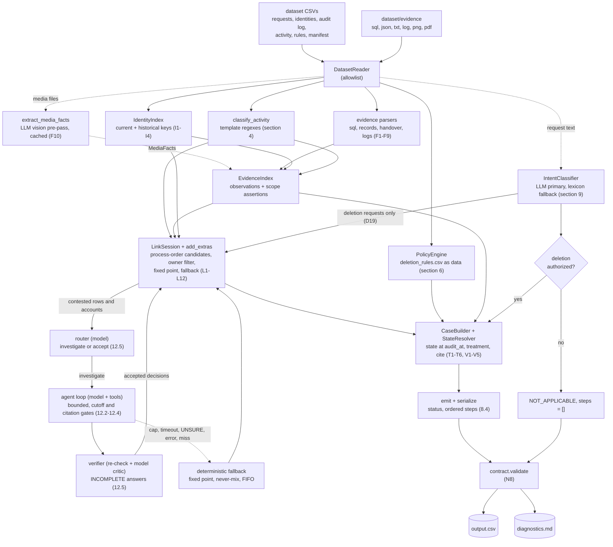

# Architecture

How the solver is laid out. The rules it implements are in [SPEC.md](SPEC.md) and the reasons behind
the non-obvious choices are in [DECISIONS.md](DECISIONS.md). Rule ids such as `L7` or `F9` below refer to
SPEC.md.

## 1. Pipeline

Dotted edges and the router, agent and verifier boxes are the only places a language model is involved. Every
other edge is a pure function of its inputs. The fallback box is the pipeline's own resolution of the contested
links; it is what runs when the agent is off or a unit falls back.

## 2. Module layering

Imports flow only downward. The table is derived from the real import graph (module-level
`ghostaudit` imports), and a module sits one level above the highest module it imports.

| Level | Modules | Role |
|---|---|---|
| 0 | `model`, `timeutil`, `config`, `keys`, `agent/ledger`, `agent/schema`, `agent/prompts` | Types, enums and the operation table; UTC epoch parsing; every tunable and flag; the single key normalizer; the citation ledger; the tool-argument schema checker; versioned prompt files |
| 1 | `dataset`, `emit`, `intent_lexicon`, `evidence/base`, `llm/client` | Allowlisted reader and typed CSV loaders; step ordering and serialization; the intent lexicon; the parser protocol; the LLM client protocol with tool-use support |
| 2 | `activity`, `identity`, `contract`, `policy`, `evidence/{sql,records,handover,logs}`, `llm/usage` | Activity template classifier; identity index; output validator; rules as data and `SYSTEM_BY_PREFIX`; one parser per text evidence family; usage meter |
| 3 | `evidence/media`, `llm/cache`, `agent/identity_view` | Pure mapping from precomputed media facts to observations; disk cache and caching client; identifiers a subject had at a moment |
| 4 | `evidence/index`, `intent`, `llm/media_extract` | Immutable evidence index; intent classifier; vision pre-pass |
| 5 | `state`, `linking`, `handcrafted` | State at `audit_at` with citation; candidate generation and extras; the hand-crafted family |
| 6 | `casebuilder`, `link_graph` | Verdicts per case; the candidate graph with the fixed point and the fallback |
| 7 | `link_solver`, `agent/model` | Link sessions that accept agent decisions; plain records of the agent stage |
| 8 | `agent/router`, `agent/units`, `agent/verifier`, `agent/workspace` | Model-driven routing; investigation units; second-stage critic; the read-only world one investigation sees |
| 9 | `agent/tools` | The six typed tools and the submit gate |
| 10 | `agent/loop` | The bounded tool-use loop |
| 11 | `agent/stage` | Router, units, verifier orchestration |
| 12 | `pipeline` | Orchestration only |
| 13 | `diagnostics` | Markdown report of a run |
| 14 | `cli`, then `code/main.py`, `code/evaluation/*`, `code/tools/*` | The command line (`ghostaudit` entry point); the three-line `main.py` shim; scorer, shipped quality checks and verification tooling; report renderer and packager (the release-process tooling lives in the unshipped `devtools/`) |

Rules of the layering:

- No module holds mutable global state. Compiled regexes and frozen lookup tables are module constants.
- Everything from `identity` to `emit` is a pure function of its inputs. I/O happens only in `dataset`,
  `llm/cache`, `emit.write_output` and `diagnostics`.
- The I/O collaborators are injected. `pipeline.run(config, reader, llm)` receives the dataset reader and
  the LLM services (client, cache, usage meter), so a test can pass a fake. The pure stages (identity
  index, policy engine, intent classifier, state resolver, case builder) are constructed inside `run` from
  the config and the parsed data.
- `evidence/media.py` never imports `llm`. It receives validated `MediaFacts` and returns observations.
- `os.environ` is read only in `config.py` (N4).
- `sample_output.csv` is read only by `evaluation/` and the tests (N3).
- Nothing under `code/` edits `sys.path`: `python3 code/main.py` finds the package because the script's own
  directory is on the path, `python3 -m evaluation` runs from `code/`, and `pip install -e code` installs the
  `ghostaudit` and `ghostaudit-eval` commands.

## 3. Data flow

1. **Read.** `DatasetReader` opens only allowlisted files. Times are parsed once into integer UTC epoch
   seconds (T6).
2. **Identity.** `IdentityIndex` builds, for each user, the set of current and historical email, hash,
   phone and `user_<n>` keys (I2) and resolves each request email to one subject (I3).
3. **Activity.** Each `system_activity.csv` row is classified by its `details` template (section 4). A row
   that matches no template is classified `UNCLASSIFIED` (inert, never guessed into a decision), warned
   about once per template shape and listed in the diagnostics; `strict=True` raises instead.
4. **Evidence.** Each manifest file is claimed by exactly one parser chosen by content. Parsers return
   `Observation` and `ScopeAssertion` records. The media pre-pass supplies `MediaFacts` for images and
   PDFs, and `evidence/media.py` maps them to observations through LINK rows or a literal id plus a
   resolvable identifier (F10, D18). `EvidenceIndex` sorts observations by `(entry_time, captured_at, manifest
   order)`.
5. **Intent.** `IntentClassifier` resolves each request text to deletion or non-deletion. A request
   that is not a deletion becomes `NOT_APPLICABLE` with `[]` steps and takes no further part.
6. **Linking.** Candidate edges between cases, accounts and worker rows follow the order of the process:
   work happens after `requested_at`, an account or policy row at or before `reported_at`, a violation,
   flow or restore row after `reported_at` and at or before `audit_at` (L2, L3). They are filtered by
   evidence ownership as of each case's own `audit_at` (L4a), narrowed to the account rows evidence ties to
   the subject (L1) and solved to a fixed point (L4). What remains contested is offered to the agent stage
   (step 7); whatever the agent does not decide is paired by the deterministic fallback (L6). `add_extras`
   then adds repopulation flows (L9), evidence-only resources (L10) and the audit records that a file of the
   case window names (L11).
7. **Agent stage.** The router (model) reads a deterministic summary of every case that has contested
   targets and returns `investigate` or `accept`. The cases to investigate are grouped into units, the
   connected components of cases that compete for the same targets, and a bounded tool-use loop decides each
   unit. The verifier re-checks and critiques the assignments of INCOMPLETE answers. The accepted decisions
   are applied by solving the links again (12). With `--agent off`, with `--llm off` or when every call
   falls back, this step returns the deterministic result unchanged.
8. **Verdicts.** `StateResolver` computes each resource's state at `audit_at` from admissible
   observations (T1, T2) and chooses the citation (T3, V5). `CaseBuilder` combines state with the policy
   treatment and applies section 8.2 and the verification-set rules (V1-V5).
9. **Emit.** `emit` turns verdicts into a status and ordered steps (8.4). `serialize` writes canonical JSON.
10. **Validate and write.** `contract.validate` checks every emitted row against the output contract
   before `write_output` writes `output.csv`. `diagnostics` writes the per-case reasons, link basis,
   flags fired, evidence and template disagreements and cache misses (N6).

## 4. Where the language model sits

The model never emits a step or a status. It has five narrow roles; the first two are read-only inputs to
the deterministic core, the last three decide only which case a contested row or account belongs to.

| Role | Module | Input | Output | Fallback when unavailable |
|---|---|---|---|---|
| Intent | `intent.py` with `prompts/intent.v1.md` | request text wrapped in delimiters, treated as data | `{deletion, confidence, language, reason}` per request, schema-checked | the lexicon in `intent_lexicon.py` decides (N7) |
| Media facts | `llm/media_extract.py` with `prompts/media_extract.v2.md` | one image or PDF | records with display id, resource hint, category, keys and state facts, schema-checked | the file yields no observation and the diagnostics say so |
| Router | `agent/router.py` with `prompts/router.v1.md` | deterministic summaries, at most 25 cases per call | `investigate` or `accept` per case, schema-checked | every case of the batch is investigated |
| Agent | `agent/loop.py` with `prompts/agent.v1.md` and `agent/tools.py` | one unit: its cases and contested targets | `submit_answer`: assign, reject or UNSURE per target, with cited ids | the unit falls back to the deterministic resolution |
| Verifier | `agent/verifier.py` with `prompts/verifier.v1.md` | the assignments of INCOMPLETE answers with their citations | `approve` or `reject` per assignment | an assignment the critic did not approve is dropped |

The agent, router and verifier use `claude-opus-5-5` (`--agent-model`, `--router-model`,
`--verifier-model`). Guardrails the model cannot override sit inside the tools and the submit gate (SPEC 12.3):
the cutoff (a tool never returns what was captured or entered after the case's `audit_at`), the policy
mapping (operations come only from `PolicyEngine`), citation validity (a `CitationLedger` records every id a
tool returned; `submit_answer` rejects any other id, a case outside the unit and a row assigned twice) and the
output schema (the final steps still come from `CaseBuilder` and `emit` and pass `contract.validate`).

Supporting facts:

- **Modes.** `--llm off` never calls a model. `--llm cache` replays stored responses and treats a miss as
  unavailable. `--llm live` calls the API for misses and stores the result. The default is `cache`.
  `--agent off` skips the router, agent and verifier whatever the LLM mode; `--agent-max-usd` caps the live
  spend of the agent stage (the loop reads the meter before every call).
- **Bounds.** One investigation makes at most `MAX_ITERATIONS = 8` model calls (`agent/loop.py`), each with a
  `CALL_TIMEOUT_S = 90` limit; a spent cap, a timeout, an LLM error, a cache miss, a submit that the gate rejects
  three times, an all-UNSURE answer or the eighth call without an answer end the unit in the fallback with
  its reason, counted in the diagnostics.
- **Cache.** `llm/cache.py` keys each request by the SHA-256 of its canonical JSON (model, system
  prompt, messages including tool-use blocks, tool definitions, `max_tokens`, prompt version, effort, schema,
  attachment hashes), so a recorded investigation replays byte for byte offline. Intent uses a
  per-item key so a verdict never depends on batch composition. Writes are atomic (temp file plus
  `os.replace`). Entries hold only the response text, token usage, the model name and the stop reason, never the
  request or a credential.
- **Calls.** The client sends no sampling parameters. It sets a fixed `max_tokens`, an explicit
  `output_config.effort`, a JSON-schema `output_config.format` and a cached system prompt. `refusal` and
  `max_tokens` stop reasons raise a typed error and the caller falls back.
- **Metering.** `UsageMeter` records calls, input and output tokens, cache reads and writes per model in
  two buckets: `live` (real API calls) and `replayed` (responses served from the cache, carrying the usage
  recorded when they were produced). `cli.py` writes the meter as `meter.json` next to the diagnostics;
  `tools/render_reports.py` renders `usage_report.md` from it and shows both buckets, because the final run
  replays a full cache and so makes no live call. Replayed usage is what a run from an empty cache spends.
- **Security.** The key is read from `ANTHROPIC_API_KEY` by `Config.from_env` only and is held in a
  `Secret` whose `repr` is `***`. The Anthropic SDK is imported lazily, so the core and the offline modes
  run on the standard library alone.

## 5. Performance budget

The offline run (`--llm off`, no cache needed) must stay well inside the 5 s gate (N2). One measured
run on the development machine (Python 3.9, 518 evaluation plus 32 sample requests, agent stage with an empty agent cache):

| Stage | Seconds (diagnostics) |
|---|---|
| media extraction (cache lookups) | 0.006 |
| evidence index (identity, 79 text files, activity, policy) | 0.132 |
| intent (cache) | 0.097 |
| links, extras and case build | 0.237 |
| agent stage (router cache miss, every unit falls back) | 0.0 to 0.2 |
| contract validation | 0.038 |
| **Process wall time, including interpreter start** | **about 1** |

The numbers are machine dependent and only the order of magnitude matters. Nothing is parallel: live
model calls also run one at a time. Optimizations are
justified only by measurement, and every run records its own stage timings in `diagnostics.md`.

## 6. Determinism guarantees

- **Ordering.** No set or dict is iterated into output without `sorted()`. Files are processed in
  manifest order, requests in natural case-id order, and ties are broken by explicit keys.
- **Time.** Integer epoch seconds only. There is no wall-clock input and no use of `datetime.now`.
- **Serialization.** `json.dumps(sort_keys=True, separators=(',', ':'), ensure_ascii=False)` for every
  step list, and `csv.writer` with `lineterminator="\n"` for the file.
- **Hash seeds.** Two runs with `PYTHONHASHSEED=0` and `PYTHONHASHSEED=4242` produce byte-identical
  `output.csv`; the shipped `python3 -m evaluation check` makes that comparison on every run.
- **Model nondeterminism is contained.** A response is cached once and replayed, so a cached rerun
  reproduces a live run byte for byte, and a prompt edit changes the cache key of exactly the entries it
  affects. See DECISIONS D1, D4 and D6.
- **Isolation.** The pipeline cannot read `sample_output.csv`, `solution/` or any organizer-only file.
  `DatasetReader` is allowlist-based and raises `ForbiddenInputError` for anything else, and a static
  test scans the shipped code (N3).

## 7. Failure behaviour

| Condition | Behaviour |
|---|---|
| Model disabled or cache miss | Lexicon decides intent; media file yields no observation; recorded in the diagnostics (N7) |
| An evidence file fails to parse | The file is skipped with a logged note that the diagnostics repeat; the run continues |
| Request email does not resolve | Hard error that is logged (I3) |
| A row matches no activity template | The row is classified `UNCLASSIFIED`, stays inert and is listed in the diagnostics |
| Output violates the contract | the CLI exits with status 1 after writing the files, naming each violation |
| Dataset or arguments unusable | the CLI exits with status 2 and a message, no traceback |
| Router call fails, or its reply is invalid | Every case of the batch is investigated (12.5) |
| Agent unit hits a cap, a timeout, an LLM error, a cache miss, repeated invalid submits or answers UNSURE | The unit falls back to the deterministic resolution; the reason is counted in the diagnostics (12.4) |
| Verifier rejects an assignment or cannot be reached | The assignment is dropped; its target goes to the fallback (12.5) |
